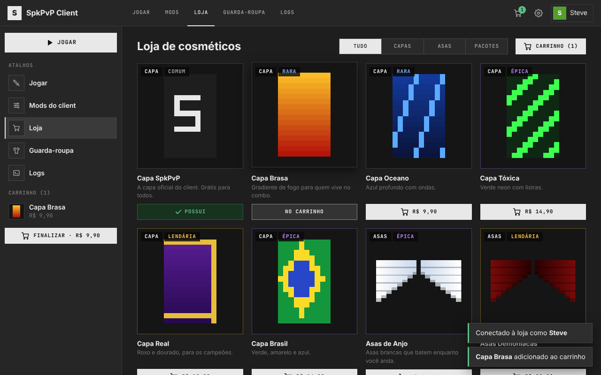
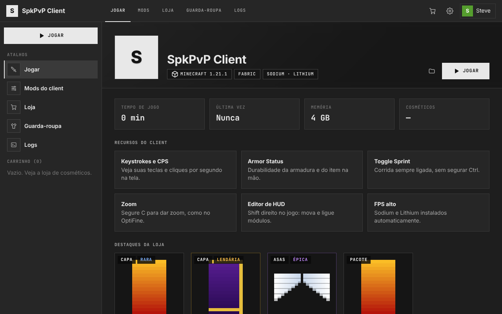
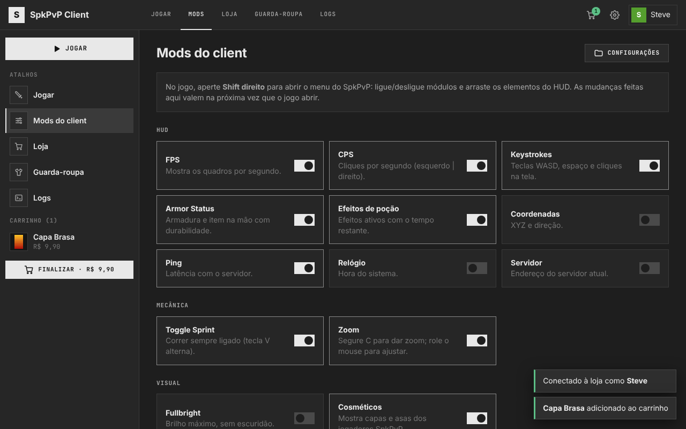
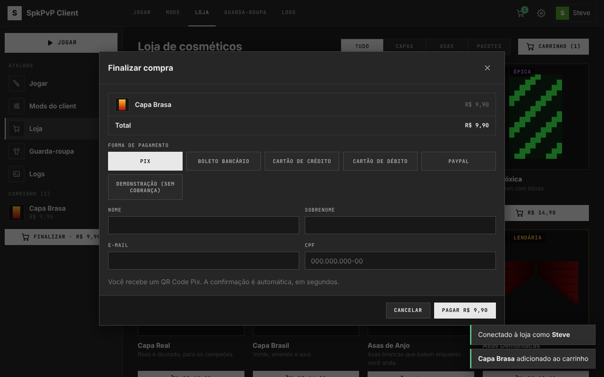

# SpkPvP Client

Client de PvP para Minecraft: Java Edition, no estilo de Lunar, Badlion e LabyMod,
com loja de cosméticos paga por **Pix, boleto bancário, cartão de crédito, cartão de
débito e PayPal**. O launcher usa a mesma interface do PackLauncher.

## Download

**[Baixar SpkPvP.exe (Windows)](https://github.com/spk768/SpkPvP-Client/releases/latest/download/SpkPvP.exe)**:
sempre a versão mais recente, compilada pelo GitHub Actions a cada atualização do repositório.
O mod (`spkpvp-1.21.1.jar`) fica na mesma [release](https://github.com/spk768/SpkPvP-Client/releases/latest)
e é baixado sozinho pelo launcher.

O `.exe` não é assinado digitalmente, então o Windows pode mostrar "O Windows protegeu o
computador": clique em **Mais informações → Executar assim mesmo**.



| Início | Mods do client | Checkout |
|---|---|---|
|  |  |  |

O projeto tem três partes:

| Pasta | O que é |
|---|---|
| `launcher/` | Launcher em Python (só biblioteca padrão). Instala o Minecraft 1.21.1 com Fabric, o mod SpkPvP, Sodium e Lithium, e tem a loja e o guarda-roupa. |
| `mod/` | Mod Fabric (Java 21) que roda dentro do jogo: HUD, mecânicas de PvP, menu e cosméticos. |
| `server/` | Servidor da loja: catálogo, login, pedidos, pagamentos e a API que o mod consulta para mostrar os cosméticos dos jogadores. |

## Recursos do client (mod)

- **HUD**: FPS, CPS (esquerdo | direito), Keystrokes (WASD, espaço, cliques),
  Armor Status (com durabilidade), efeitos de poção, coordenadas, ping, relógio e servidor.
- **Editor de HUD**: `Shift direito` abre o menu do client; em **Editar HUD**, arraste os módulos.
- **Toggle Sprint** (`V` alterna), **Zoom** (segure `C`, role o mouse para ajustar), **Fullbright**.
- **Cosméticos**: capas e asas compradas na loja aparecem para todos os jogadores que usam o SpkPvP.
- As teclas podem ser trocadas em *Opções → Controles → SpkPvP Client*.
- Os módulos também podem ser ligados/desligados no launcher (aba **Mods**): os dois
  editam o mesmo `config/spkpvp/modules.json`.

Cosméticos são apenas visuais e não dão vantagem no jogo. O client não tem nenhum recurso
de trapaça (reach, autoclicker, etc.).

## Launcher

```bash
cd launcher
python -m spkpvp        # abre a interface
```

Telas: **Jogar** (botão grande, tempo de jogo, destaques da loja), **Mods** (módulos do
client), **Loja** (capas, asas e pacotes, carrinho), **Guarda-roupa** (equipar o que
comprou, histórico de pedidos) e **Logs**. Contas offline e Microsoft funcionam como no
PackLauncher (o login Microsoft exige um Client ID do Azure; veja abaixo).

Ao clicar em **Jogar**, o launcher:

1. cria (uma vez) a instância `SpkPvP 1.21.1` com Fabric;
2. instala/atualiza Fabric API, Sodium e Lithium pelo Modrinth;
3. baixa o mod SpkPvP da [release mais recente](../../releases/latest)
   (ou usa o caminho/URL definido em *Configurações → Mod SpkPvP*);
4. grava `config/spkpvp/client.json` com o endereço da loja e abre o jogo.

O `.exe` para Windows é gerado pelo GitHub Actions (aba Releases).

### Login Microsoft

Igual ao PackLauncher: crie um app no [Azure](https://portal.azure.com) (contas pessoais,
"Allow public client flows"), peça a aprovação da Mojang ([formulário](https://aka.ms/mce-reviewappid))
e coloque o Client ID em *Configurações*.

## Servidor da loja

```bash
cd server
SPK_DEV=1 python -m spkserver      # modo de desenvolvimento em http://127.0.0.1:8787
```

Em produção, rode atrás de HTTPS (nginx/Caddy) e configure pelas variáveis de ambiente:

| Variável | Para quê |
|---|---|
| `SPK_PUBLIC_URL` | URL pública HTTPS do servidor (links de retorno e webhooks). |
| `SPK_HOST` / `SPK_PORT` | Endereço de escuta (padrão `127.0.0.1:8787`). |
| `SPK_DB` | Arquivo SQLite (padrão `spkpvp.db`). |
| `MP_ACCESS_TOKEN` | Access token do **Mercado Pago**: ativa Pix, boleto, crédito e débito. |
| `MP_WEBHOOK_SECRET` | Chave secreta dos webhooks do Mercado Pago (valida `x-signature`). |
| `PAYPAL_CLIENT_ID` / `PAYPAL_SECRET` | Credenciais REST do **PayPal**: ativa o PayPal. |
| `PAYPAL_ENV` | `sandbox` (padrão) ou `live`. |
| `PAYPAL_WEBHOOK_ID` | Id do webhook no PayPal (valida a assinatura dos eventos). |
| `SPK_DEV` | `1` aceita contas offline e o método "Demonstração" (sem cobrança). **Nunca** em produção. |

Nos painéis, cadastre os webhooks:

- Mercado Pago: `https://SEU_DOMINIO/webhooks/mercadopago` (evento *Pagamentos*);
- PayPal: `https://SEU_DOMINIO/webhooks/paypal` (eventos `CHECKOUT.ORDER.APPROVED` e `PAYMENT.CAPTURE.COMPLETED`).

Depois aponte o launcher para o servidor em *Configurações → Servidor da loja*.

### Como os pagamentos funcionam

| Método | Provedor | Fluxo |
|---|---|---|
| Pix | Mercado Pago | QR Code e "copia e cola" no próprio launcher; confirma em segundos. |
| Boleto | Mercado Pago | Linha digitável e PDF no launcher (exige CPF e endereço); compensa em até 3 dias úteis. |
| Crédito / Débito | Mercado Pago (Checkout Pro) | Abre o checkout do Mercado Pago no navegador; o cartão nunca passa pelo SpkPvP. Crédito em até 12x. |
| PayPal | PayPal Orders v2 | Abre o PayPal; o pagamento é capturado quando o jogador volta. |

Regras de segurança:

- Preços ficam só no servidor (`server/spkserver/catalog.py`); o launcher manda apenas ids.
- Um pedido só é entregue depois de o servidor **consultar o provedor** e conferir status
  aprovado e valor pago ≥ total. Webhooks apenas disparam essa consulta (e têm a assinatura validada).
- A entrega é idempotente: webhook repetido, retorno do navegador e consulta do launcher não duplicam nada.
- Login na loja sem senha: o launcher usa o protocolo de sessão da Mojang
  (`session/minecraft/join` + `hasJoined`), o mesmo que servidores usam para validar jogadores.

### API

| Rota | |
|---|---|
| `GET /api/catalog` | Itens, slots e métodos de pagamento ativos. |
| `POST /api/auth/challenge` → `POST /api/auth/verify` | Login com conta Minecraft. |
| `GET /api/me`, `POST /api/equip` | Cosméticos do jogador (Bearer token). |
| `POST /api/checkout`, `GET /api/orders/{id}` | Compra e status do pedido. |
| `GET /api/players/{uuid}/cosmetics` | Público: o que o jogador tem equipado (usado pelo mod). |
| `GET /textures/{id}.png` | Texturas (capas 64×32, asas 32×32). |

Para adicionar cosméticos, inclua o item em `catalog.py` e a textura em
`server/spkserver/textures/` (as atuais são geradas por `python tools/gen_textures.py`).

## Mod

```bash
cd mod
gradle build            # Gradle 8.10+, Java 21 -> build/libs/spkpvp-1.21.1-*.jar
```

Para testar uma versão local no launcher, coloque o caminho do `.jar` em
*Configurações → Mod SpkPvP*.

## Testes

```bash
python -m unittest discover -s tests -v
```

## Observações

- Suporta Minecraft 1.21.1 (o mod depende de mixins dessa versão).
- Contas offline só entram na loja com o servidor em modo dev; em produção a posse da
  conta é verificada pela Mojang.
- O Fullbright grava o brilho acima de 100% enquanto está ligado; se o jogo fechar com ele
  ativo, o Minecraft volta o brilho ao padrão ao reabrir.
